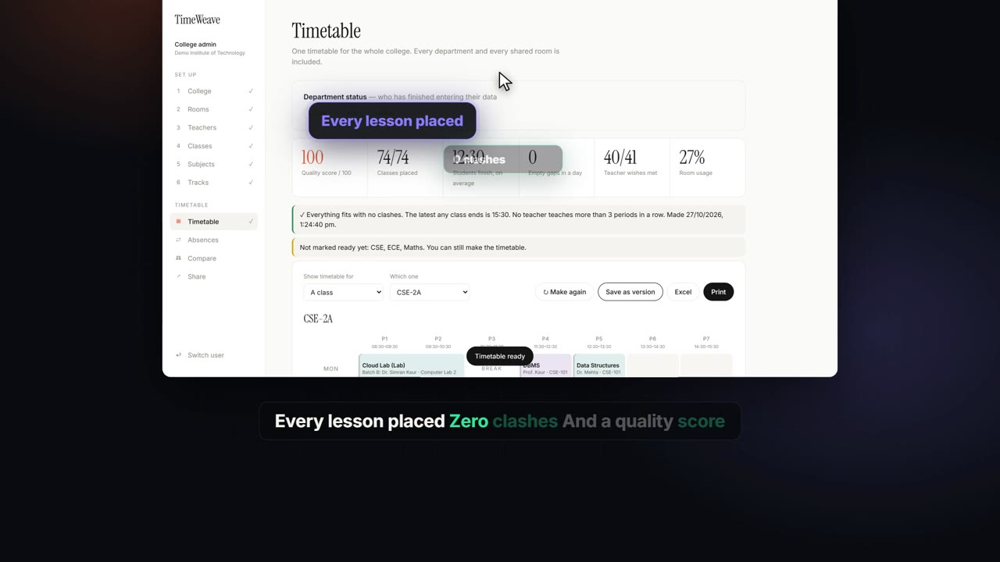
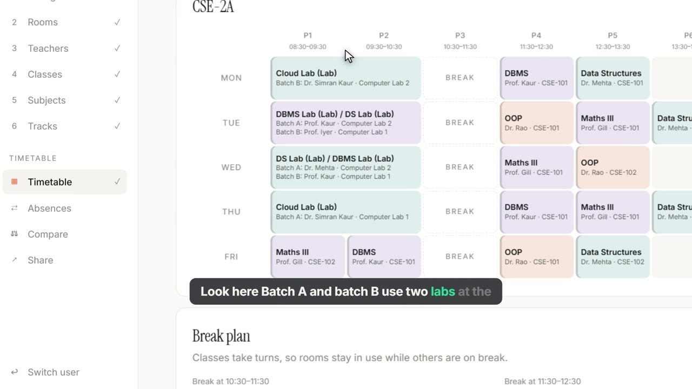
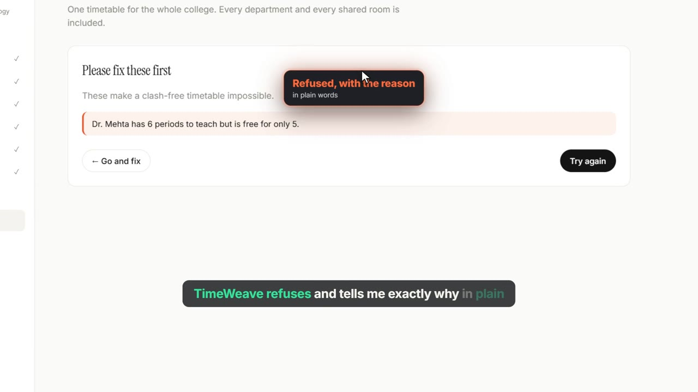
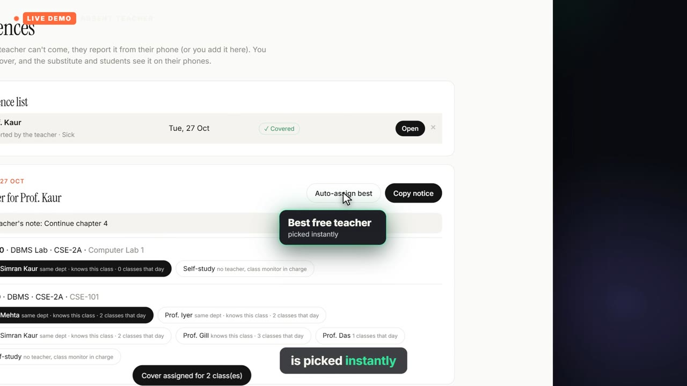
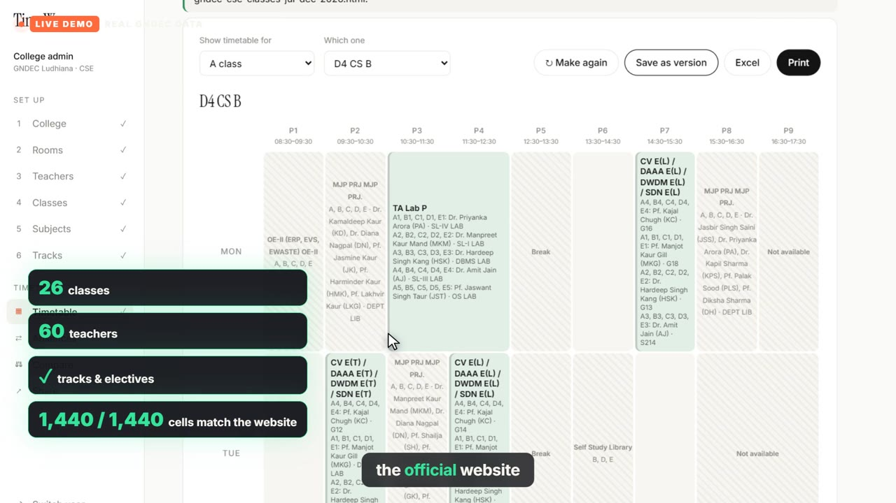
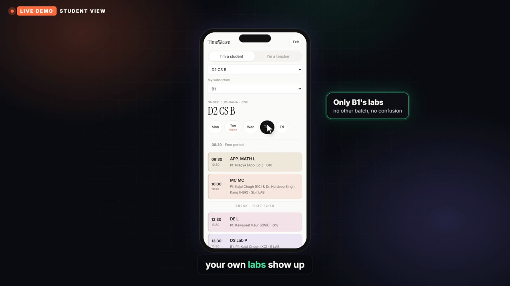

# TimeWeave

**Clash-free college timetables in seconds, not weeks.**

Most colleges still build timetables by hand at the start of every semester. It takes weeks, departments compete for shared labs and seminar halls, and the result still has clashes, uneven teaching loads and rooms that sit empty. TimeWeave is a web app that builds the whole college's timetable in one click, then keeps it working through absences, sharing and real-world changes.



## Demo

- **Live (GitHub Pages):** [ekam-07.github.io/time-weave](https://ekam-07.github.io/time-weave/)
- **Real GNDEC CSE timetable, straight away:** [ekam-07.github.io/time-weave/?sample=gndec](https://ekam-07.github.io/time-weave/?sample=gndec)
- **Demo video:** *(add your link here, e.g. a GitHub Release asset or YouTube)*
- **Try it locally:** open `index.html` in any modern browser, click **Load a demo college**, and log in as admin with PIN **1234**.

## Real data: GNDEC CSE

The repo ships with the Computer Science department of GNDEC Ludhiana's July–Dec 2026 timetable, imported from the department's published FET export (`data/gndec-cse-classes-jul-dec-2026.html`): 26 classes, 60 teachers, 515 lessons, with all 1,440 cells matching the published version.

- Open `index.html?sample=gndec` (or click **Load GNDEC CSE timetable** on the home screen).
- PINs for this copy: admin `1234`, CSE head `1111`, App. Sci. head `2222`. Students need no PIN.
- As a student, pick your class, your subsection (for example B1) and, from 3rd year, your track.
- To test the importer yourself: admin → **College** → **Import FET timetable** → choose `data/gndec-cse-classes-jul-dec-2026.html`.

## Who uses it

| Role | What they do |
|---|---|
| **College admin** | Sets up the week, rooms and breaks, makes one timetable for every department, compares versions, shares links |
| **Department head** | Logs in with a department PIN, fills in only their own teachers, classes and subjects, marks the department ready |
| **Students & teachers** | See their own timetable on the phone, day by day; teachers report absences |

## Features

**Building the timetable**
- Six guided steps: College → Rooms → Teachers → Classes → Subjects → Tracks
- One click places every lesson, then a second pass compacts each day (earlier finish, no empty gaps)
- **Staggered breaks**: classes take turns (for example 10:30 or 11:30) so rooms never sit empty
- **Lab batches**: a class bigger than its lab is split automatically; Batch A and Batch B use two labs at once, then swap
- **Co-teachers** and **combined lessons** (tracks and electives shared across sections)
- Plain-language checks before generating, for example *"Dr. Mehta has 6 periods to teach but is free for only 5"*

**Rules**
- Strict, never broken: no teacher, room or student group double-booked; time off, breaks and fixed hours respected; rooms must fit the class; daily limits; at most 3 periods in a row per teacher
- Wishes, optimised as far as possible: finish early, no gaps, a subject spread across the week, teacher preferences ("mornings only")

**Quality score (out of 100)**
- Deducts for missing lessons, empty gaps, the same subject twice in a day and unmet wishes, measured per class per day so big and small colleges are judged fairly
- Save versions and compare them side by side

**Real life**
- **Absences**: a teacher reports from the phone with a note → admin auto-assigns the best free substitute (or self-study) → copy a WhatsApp-ready notice → students see "Substitute today"
- **Student phone view** with **subsection** (B1 / B2) and **track** filters (from 3rd year), so each student sees only their own lectures and labs
- Share links and QR codes for every class and teacher
- Print and Excel (CSV) export

**Import**
- **Excel / CSV** upload of classes, teachers and subjects (template in the app; sample in [`docs/sample-import.csv`](docs/sample-import.csv))
- **FET timetable import**: reads the HTML that many colleges publish from FET. Tested on the GNDEC Computer Science department's July–Dec 2026 timetable: 26 classes, all 1,440 cells matching the published version

| | |
|---|---|
|  |  |
|  |  |



## Running it

TimeWeave is a single HTML file with no build step and no server.

1. Open `index.html` in Chrome, Edge or Firefox.
2. Click **Load a demo college** (demo PINs: admin `1234`, CSE `1111`, ECE `2222`, Maths `3333`), or log in as admin with `1234` and start from scratch.

To use share links and QR codes on other phones, host the folder anywhere static (GitHub Pages, Netlify). To serve it locally:

```bash
python -m http.server 8080
```

QR codes and `.xlsx` upload load small libraries from a CDN, so they need internet; everything else works offline.

### Importing a college's existing FET timetable

Log in as admin → **College** → **Import FET timetable** → choose the students/groups HTML export → tick the years to include → **Import**. Lessons TimeWeave can't re-schedule (open electives, project panels) are kept exactly where they are and block those hours.

## How it works

```
College · Rooms · Teachers · Classes · Subjects   (or Excel / FET import)
                         │
                         ▼
   Check  →  Place under strict rules  →  Compact days  →  Score
                         │
                         ▼
 Class / teacher / room grids · phone views · share links · absences · versions
```

All data is stored in the browser's local storage. **Save file** / **Open file** on the College page back it up as JSON.

## Limitations

- Data lives in one browser: department heads on different computers can't yet edit the same timetable live, and absences don't sync to other phones. A shared backend is the next step.
- Logins are PINs stored with the data, which is fine for a demo but not real security.
- On large imported timetables, a generated timetable can occasionally leave a few lessons unplaced; press **Make again** or keep the imported version.
- Class sizes and room seats aren't in FET exports, so imports assume 60 students per class, 36 seats per lab and 72 per classroom. Correct them on the Rooms and Classes pages.

## Roadmap

- Shared online database so every department and phone stays in sync
- Drag-and-lock manual edits
- Smarter search (swapping lessons) so every lesson fits on very large timetables
